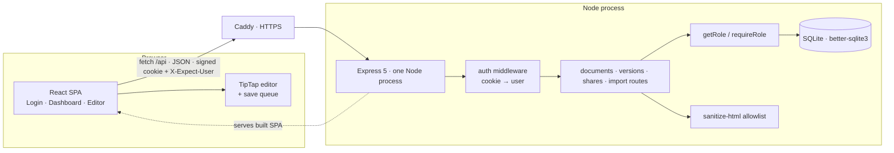
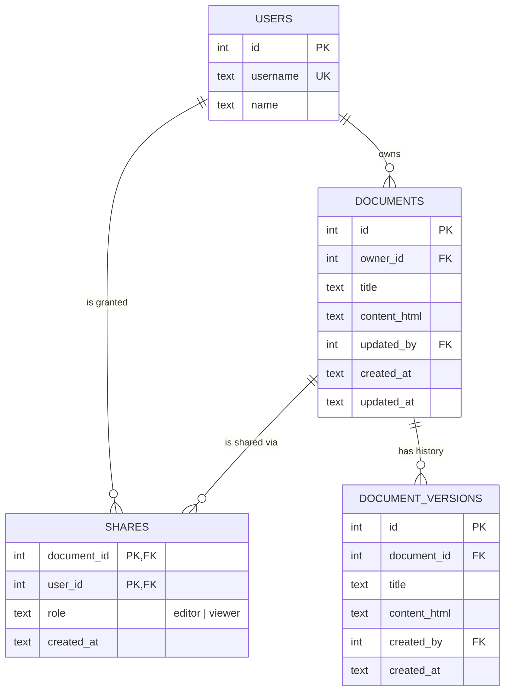
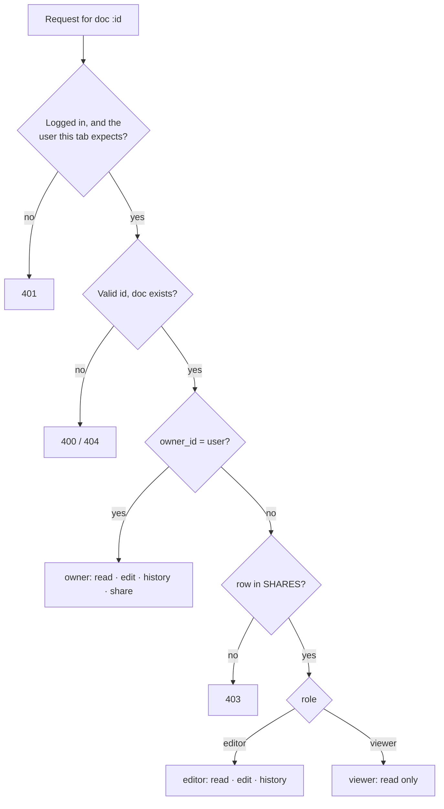
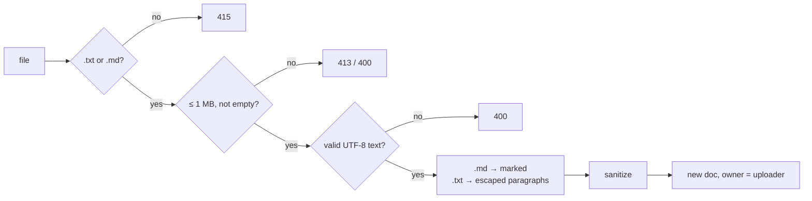

# Architecture

Ajaia Docs is a lightweight collaborative document editor: create, format, import, share and restore documents.
This note covers what was built, why, and what was traded away. Scope decisions are in [SPEC.md](SPEC.md).

## 1. What I prioritized and why

The brief rewards **depth in a few areas over shallow coverage**. I put the time into the parts a real team
would notice first:

1. **Saving that never loses or scrambles work**: autosave with exactly one save in flight per tab, retry when
   offline, a save on tab close, and version history as a safety net.
2. **Sharing that's enforced on the server**: owner / editor / viewer roles checked on every route, with an
   automated sweep proving that a user without access gets 403 everywhere.
3. **Safe content**: one sanitizer allowlist for everything that's stored (typed, pasted or uploaded).
4. **A testable, honest deployment**: live HTTPS link, deploys only from pushed commits, tests run before every
   restart.

Deliberately **not** built: real-time co-editing, comments, real authentication, `.docx` (see §9).

## 2. Scope to components

| Scope area | Frontend | Backend | Data |
|---|---|---|---|
| Creation & editing | Editor page (TipTap), toolbar, title rename, save queue | `/api/documents` | `documents` |
| Version history | History panel | `/api/documents/:id/versions` | `document_versions` |
| File upload | Upload button with stated limits | `/api/documents/import` (multer → marked → sanitizer) | `documents` |
| Sharing | Share dialog, role badges, read-only viewer mode | `/api/documents/:id/shares`, `getRole` / `requireRole` | `shares` |
| Persistence | — | better-sqlite3 | SQLite file |

## 3. System overview



One process, one port, one database file: the fewest moving parts that still cover frontend, backend, persistence
and access logic, with nothing for reviewers to pay for or install beyond `npm`.

## 4. Stack: choices, alternatives, reasons

| Layer | Chosen | Alternatives considered | Why |
|---|---|---|---|
| Frontend | **React 19 + Vite** | Next.js, Vue, SvelteKit | Plain SPA, instant dev server, static build. Next.js adds SSR/routing we don't need |
| Editor | **TipTap 3** (StarterKit, trimmed) | Quill, Lexical, Slate, raw `contenteditable` | All required formats out of the box with a strict schema. Quill is dated; Lexical/Slate need more wiring; raw `contenteditable` is a bug farm |
| Backend | **Node 22 + Express 5** | Fastify, NestJS, Next API routes, FastAPI | Minimal and well known; one language end to end. NestJS is heavy for this size |
| Database | **SQLite** (better-sqlite3) | Postgres, Supabase, JSON files | Zero setup, real SQL with foreign keys and transactions, survives restarts. Postgres needs a server; Supabase adds an account; JSON files have no integrity |
| Upload | **multer + marked + sanitize-html** | Client-side parsing, mammoth (`.docx`) | Server-side validation can't be bypassed; one sanitizer for all content |
| Auth | **Pick-a-user + signed cookie** | Passwords, OAuth | The brief allows mocked auth; time went into the product |
| Tests | **Vitest + Supertest**, autocannon for load | Jest, Playwright E2E in CI | Fast API and unit tests against an in-memory DB. Browser checks were scripted separately (see §8) |
| Deploy | **VPS: systemd + Caddy** | Render, Railway, Vercel | Free, automatic HTTPS, no cold starts, persistent disk. Vercel functions can't keep a SQLite file; free Render instances sleep and lose their disk |

## 5. Data model



- **Content is stored as sanitized HTML**, TipTap's native output. Uploads produce HTML too, so one format covers
  editing, import and history. The allowlist is `p, h1–h3, strong, em, u, ul, ol, li, br` with no attributes:
  scripts, event handlers, styles, links, images and iframes can never be stored. The editor is configured with
  the same formats, so what you see is what's saved.
- `shares (document_id, user_id)` is the primary key: sharing again **updates** the role instead of duplicating.
- `shares` and `document_versions` cascade on document delete.
- `updated_by` lets a version show **who wrote that state**, not just who triggered the snapshot.

## 6. API

All JSON. Errors are `{ "error": "message", "code"?: "SESSION_CHANGED" | "LOGGED_OUT" }`.

| Method | Route | Allowed | Notes |
|---|---|---|---|
| GET | `/api/users` | anyone | login picker, share dialog |
| POST | `/api/login` · `/api/logout` | anyone | `{username}` → signed, HttpOnly, SameSite=Lax cookie |
| GET | `/api/me` | logged in | current user |
| GET | `/api/documents` | logged in | `{ owned, shared }`; shared rows include owner name and role |
| POST | `/api/documents` | logged in | `{title?}` → new doc owned by caller |
| GET | `/api/documents/:id` | owner, editor, viewer | includes `role` and `owner_name` |
| PATCH | `/api/documents/:id` | owner, editor | `{title?, content_html?}`; may snapshot a version |
| GET | `/api/documents/:id/versions` | owner, editor | newest first, max 10 |
| POST | `/api/documents/:id/versions/:vid/restore` | owner, editor | snapshots current state, then restores |
| GET / POST | `/api/documents/:id/shares` | owner | `POST {username, role}` (upsert) |
| PATCH / DELETE | `/api/documents/:id/shares/:userId` | owner | change role / revoke |
| POST | `/api/documents/import` | logged in | multipart `file`, `.txt`/`.md`, ≤ 1 MB → new doc |

**Status codes:** 400 invalid input · 401 not logged in / session changed · 403 no access or role too low ·
404 not found · 413 too large · 415 unsupported file type. Nothing returns a stack trace.

## 7. Key logic

### 7.1 Access control



One helper, `getRole(user, doc)`, plus a route guard `requireRole('owner', 'editor', …)` on every document route.
The viewer's read-only UI is a convenience; the server is the protection.

### 7.2 Autosave: last write wins, never out of order

The race risk is on the client: if save #1 is still in flight when save #2 fires, they could arrive out of order and
older content would overwrite newer. `saveQueue.js` therefore allows **at most one save in flight per tab**:

```mermaid
flowchart TD
  T[User types] --> D[debounce 800 ms · "Saving…"]
  D --> Q{save in flight?}
  Q -- no --> P[PATCH content]
  Q -- yes --> M[keep newest value pending]
  P --> R{result}
  R -- ok, more pending --> P
  R -- ok --> OK["All changes saved"]
  R -- network / 5xx --> RT[keep content · retry in 2 s]
  R -- 401 / 403 / 413 --> ST[stop · explain to the user]
```

- **Across users**, editing the same document at the same moment: last write wins. Accepted and documented;
  version history is the recovery path.
- **Closing the tab** with unsaved text: the browser warns; if the user leaves anyway, the pending text is sent with
  `fetch(…, { keepalive: true })`, which outlives the page.
- **Access revoked while editing**: the next save gets 403, the editor locks, and a banner explains it.

### 7.3 Version history

- On save, if the newest version is **older than 60 s** (or none exists), the *previous* state is stored first.
  Saving a version on every autosave would fill the 10 slots in seconds.
- Keep the **newest 10** per document; snapshot, update and prune run in **one transaction** (tested by forcing a
  failure halfway).
- **Restore** snapshots the current state first, so a restore can itself be undone.

### 7.4 Sessions across tabs

All tabs in a browser share one login cookie, so "Switch user" in one tab silently changes who the others are.
Without a guard, Alice's open tab could have saved **as Bob**. Each request therefore sends `X-Expect-User`; if it
doesn't match the cookie the server refuses with `401 SESSION_CHANGED`. Tabs also tell each other about
login/logout (BroadcastChannel, with a re-check on focus), and the affected tab offers **Continue as Alice** (which
re-sends pending edits) or **Go to login**.

### 7.5 Upload



## 8. Quality and operations

- **Validation & errors:** titles 1–200 characters (trimmed), content ≤ 1 MB, positive integer ids, known roles,
  JSON errors everywhere; malformed JSON → 400.
- **Security headers:** Content-Security-Policy (only our own scripts), `X-Frame-Options: DENY`, `nosniff`,
  `Referrer-Policy`. Parameterized SQL only.
- **Tests:** 58 automated tests (API, permission matrix, IDOR sweep, sanitizer, upload, versions, autosave queue,
  session guard) and a 6-check stress suite (50-connection load at p99 ≈ 140 ms, same-document races, upload abuse
  with memory plateau, share churn, hard kill mid-write). Browser flows (formatting, sharing between three users,
  mobile layout, offline/online, close-tab save, CSP violations) were verified with scripted headless Chrome runs.
  Details and results: [TEST.md](TEST.md).
- **Deployment:** `deploy/deploy.sh` runs in a separate production checkout: fetch `main` → `npm ci` → `npm test`
  → build → restart → health check. Data lives outside the code directory. This came from a real incident: early
  on, production served files from the working folder, so an unapproved local build went live against an old
  backend (see AI_WORKFLOW.md).

## 9. Trade-offs

| Kept | Gave up | Why |
|---|---|---|
| Mocked login (pick a user, signed cookie) | Real authentication | Brief allows it; time went into editing and sharing |
| One process + SQLite file | Horizontal scaling, managed DB | Zero setup, easy to run and review; WAL mode handles this load (p99 ≈ 140 ms at 50 connections) |
| Autosave, one-in-flight queue, last write wins | Real-time co-editing, conflict merging | CRDT/websockets is a large cost; history covers recovery |
| Last 10 versions, ≤ 1 per minute | Per-keystroke history, version previews | Useful restore points with bounded storage |
| Sanitized HTML storage | Structured JSON queries on content | One format for editor, import and history; the allowlist guards against XSS |
| Two share roles (editor, viewer) | Commenter, per-section or link sharing | Covers the real need with one column and one guard |
| `.txt` / `.md` import | `.docx` | Reliable first; `.docx` adds a parser and more edge cases |
| One login per browser | Simultaneous users in one browser | Matches a real cookie session; guarded so a tab never saves as the wrong user |

## 10. What I'd build next (2–4 hours)

1. **Delete document** and **export to Markdown** (small, expected).
2. **`.docx` import** via mammoth through the same sanitizer.
3. **Conflict warning**: send the `updated_at` you loaded with each save, so the server can warn "Bob changed this
   while you were editing" instead of silently taking the last write.
4. **Version preview** before restoring, and the viewer "Can view history" option.
5. Real auth (passwords or OAuth) and Postgres if it moved beyond a demo.
