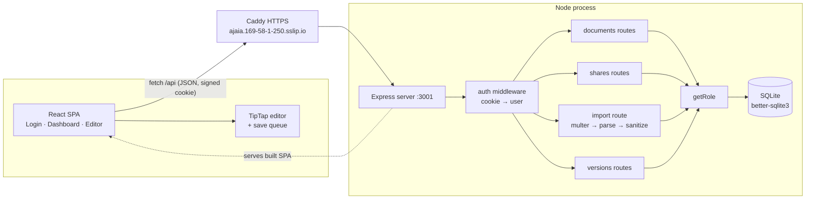
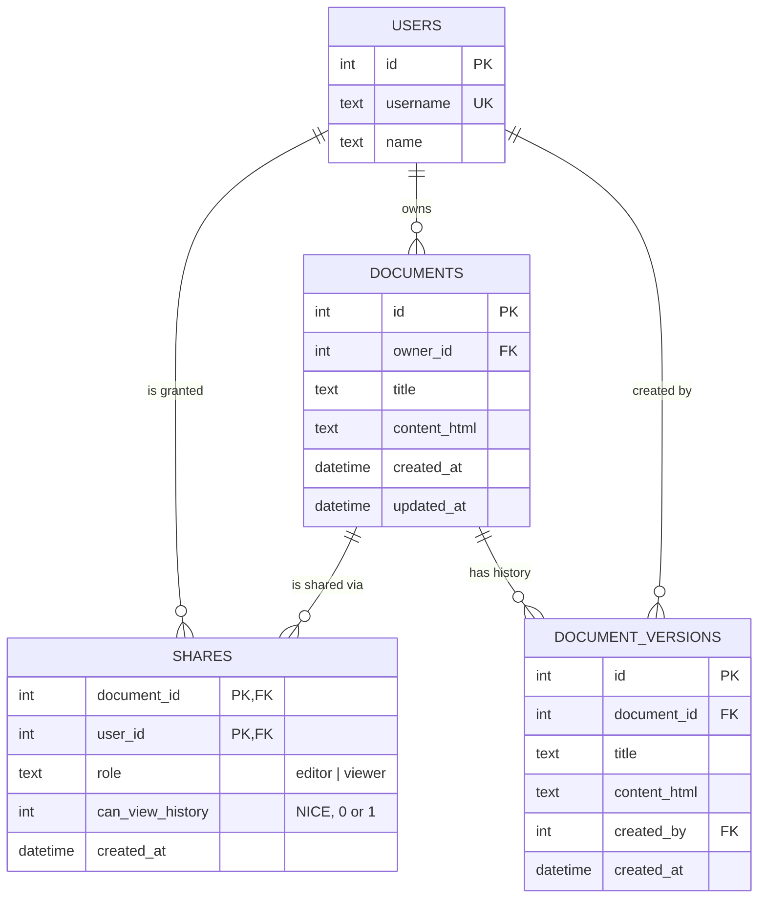
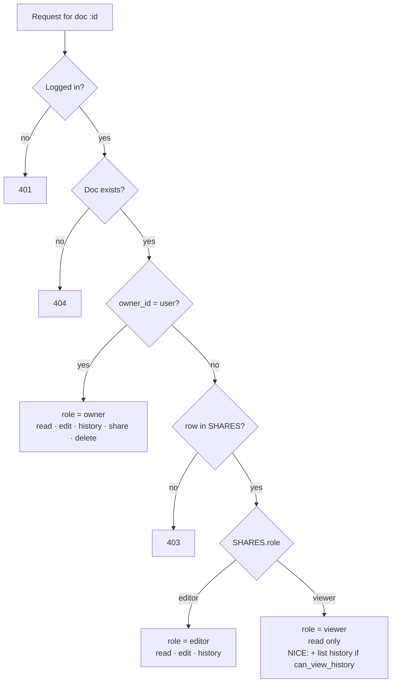
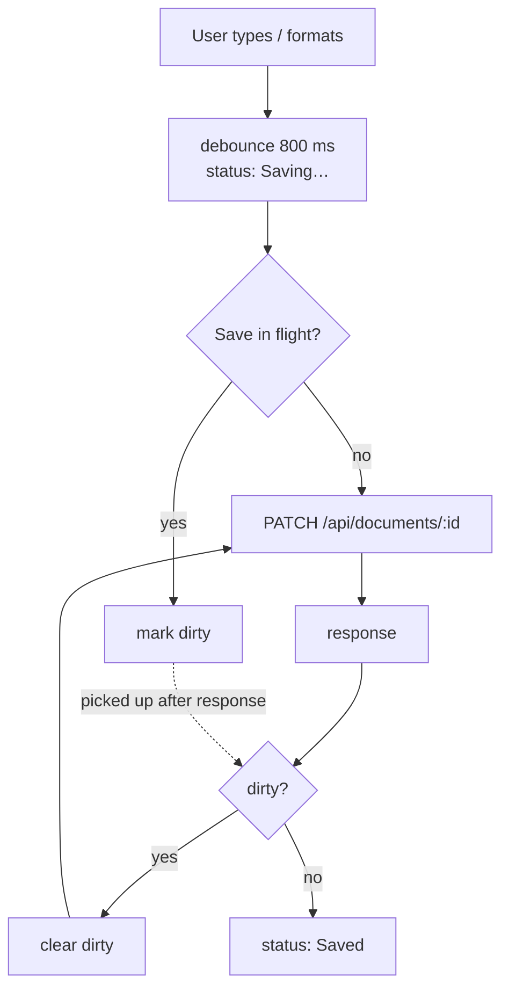
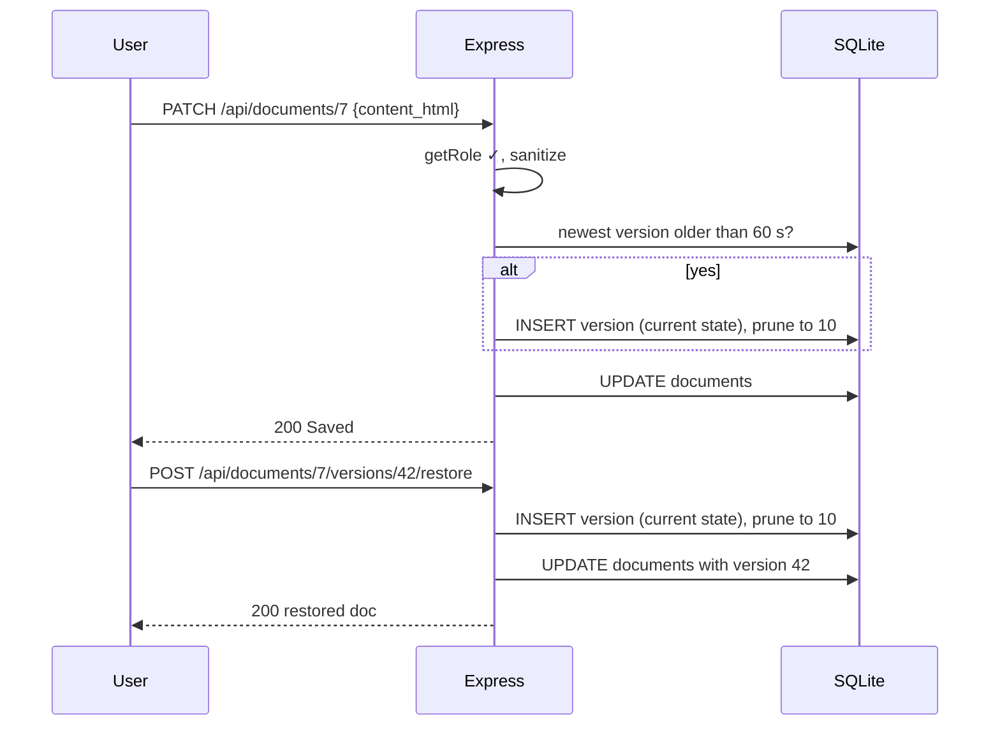
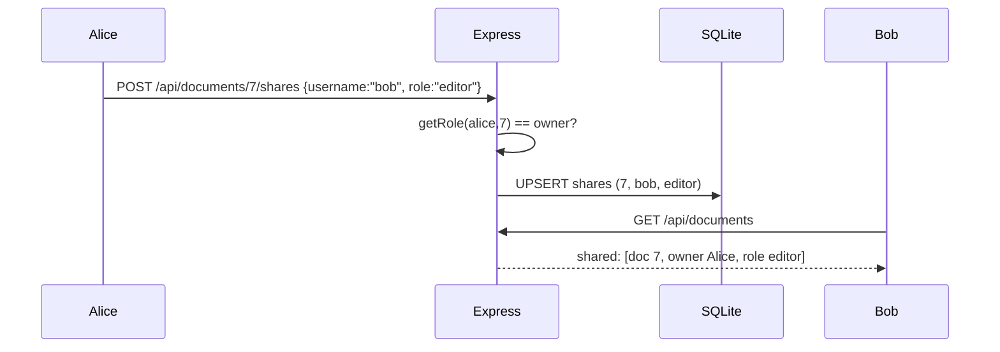
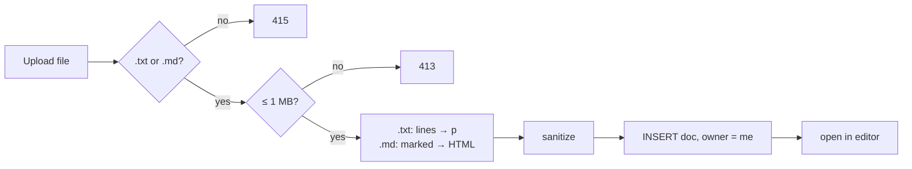

# Architecture

Lightweight collaborative document editor: create, format, import, share and restore documents.
Derived directly from the approved scope (see SPEC.md).

## 1. From scope to components

| Scope area | Needs | Component |
|---|---|---|
| Creation & editing | Rich-text editor, rename, autosave | **Frontend**: React + TipTap editor page with save queue |
| | Create / read / update docs | **Backend**: `/api/documents` routes |
| | Version history + restore | **Backend**: `/api/documents/:id/versions`; **Frontend**: History panel |
| File upload | Accept `.txt` / `.md`, validate, convert to rich text | **Backend**: `/api/documents/import` (multer + marked + sanitize-html) |
| | Upload button with stated limits | **Frontend**: dashboard upload control |
| Sharing | Users, login, owner, grant access, owned vs shared | **Backend**: auth middleware, `/api/documents/:id/shares`, `getRole()` |
| | Share dialog, two dashboard lists | **Frontend**: dashboard + share dialog |
| Persistence | Docs, versions, shares, users survive refresh/restart | **Database**: SQLite file (`data/app.db`) |

## 2. System overview



One process, one port, one DB file: the fewest moving parts that still cover frontend, backend, persistence and
access logic, with nothing for reviewers to pay for or install beyond `npm`.

## 3. Tech stack: choices, alternatives, reasons

| Layer | Chosen | Alternatives considered | Why ours |
|---|---|---|---|
| Frontend | **React + Vite** | Next.js, Vue, SvelteKit | Plain SPA, instant dev server, static build. Next.js adds SSR/routing we don't need |
| Editor | **TipTap** (StarterKit + Underline) | Quill, Lexical, Slate, raw `contenteditable` | All required formats out of the box with a clean schema. Quill is dated; Lexical/Slate need more wiring; raw `contenteditable` is a bug farm |
| Backend | **Node 22 + Express** | Fastify, NestJS, Next API routes, FastAPI | Minimal, widely known, one language front to back. NestJS is heavy for this size |
| Database | **SQLite** (better-sqlite3) | Postgres, Supabase, JSON files | Zero setup, real SQL with foreign keys and transactions, survives restarts. Postgres needs a server; Supabase adds an account dependency; JSON files have no integrity |
| Upload parsing | **multer + marked + sanitize-html** | Client-side parsing, mammoth (`.docx`) | Server-side validation can't be bypassed; sanitizing blocks XSS. `.docx` stays NICE |
| Auth | **Pick-a-user + signed cookie** | Passwords, OAuth, Supabase Auth | Brief allows mocked auth; time goes into the product |
| Tests | **Vitest + Supertest** | Jest, Playwright E2E | Fast API tests against an in-memory DB. E2E is slower to write and more fragile |
| Deploy | **This VPS: systemd + Caddy** | Render, Railway, Vercel + DB | Free, automatic HTTPS, no cold starts. Vercel serverless can't keep a SQLite file; Render free tier sleeps and loses its disk |

## 4. Data model



- Seeded users: `alice`, `bob`, `carol`.
- `SHARES` primary key `(document_id, user_id)` prevents duplicate grants; sharing again updates the role (upsert).
- `SHARES.role` is `CHECK (role IN ('editor','viewer'))`.
- **NICE:** `SHARES.can_view_history` (default 0). Only meaningful for viewers: when 1, the viewer may *list*
  versions (read-only); restore stays owner/editor only. Added only if time remains.
- `SHARES` and `DOCUMENT_VERSIONS` use `ON DELETE CASCADE` from `DOCUMENTS`.
- **Content is stored as sanitized HTML** (TipTap's native output). Import produces HTML too, so one format covers
  editing, upload and history. Sanitized on every write with an allowlist: `p, h1–h3, strong, em, u, ul, ol, li, br`.

## 5. API

All responses are JSON. Errors: `{ "error": "message" }`.

| Method | Route | Who | Notes |
|---|---|---|---|
| GET | `/api/users` | public | login picker and share dialog |
| POST | `/api/login` | public | `{username}` → sets signed cookie |
| POST | `/api/logout` | any | clears cookie |
| GET | `/api/me` | logged in | current user |
| GET | `/api/documents` | logged in | `{ owned: [...], shared: [...] }`; shared items include owner name and role |
| POST | `/api/documents` | logged in | `{title?}` → new doc, caller is owner |
| GET | `/api/documents/:id` | owner, editor, viewer | includes `role: "owner" \| "editor" \| "viewer"` |
| PATCH | `/api/documents/:id` | owner, editor | `{title?, content_html?}`; may snapshot a version |
| DELETE | `/api/documents/:id` | owner | (NICE) |
| POST | `/api/documents/import` | logged in | multipart `file`; `.txt`/`.md`, ≤ 1 MB → new doc |
| GET | `/api/documents/:id/shares` | owner | users with access |
| POST | `/api/documents/:id/shares` | owner | `{username, role}`; upsert |
| PATCH | `/api/documents/:id/shares/:userId` | owner | `{role, can_view_history?}` change role (checkbox is NICE) |
| DELETE | `/api/documents/:id/shares/:userId` | owner | revoke |
| GET | `/api/documents/:id/versions` | owner, editor (NICE: viewer with `can_view_history`) | last 10, newest first |
| POST | `/api/documents/:id/versions/:vid/restore` | owner, editor | snapshots current state, then restores |

**Status codes:** 400 invalid input · 401 not logged in · 403 no access · 404 not found ·
413 file too large · 415 unsupported file type.

## 6. Access logic



One helper, `getRole(userId, docId)` → `"owner" | "editor" | "viewer" | null`, plus a
`requireRole(...allowed)` guard used by every document route (e.g. PATCH allows `owner, editor`). Roles are enforced
on the backend; the viewer's read-only UI is a convenience, not the protection. This is the main target of the
automated tests.

## 7. Key flows

### 7.1 Autosave: last write wins, no out-of-order saves

The race risk is on the client: if save #1 is still in flight when save #2 fires, they could arrive out of order and
older content would overwrite newer. The editor therefore runs a **save queue: at most one save in flight per tab**.



- Within one tab, saves are strictly sequential, so they never arrive out of order.
- On the server, each SQLite write is atomic (all or nothing).
- **Across users** (Alice and Bob editing the same doc at once): **last write wins**. Accepted and documented;
  version history is the safety net.

### 7.2 Version history

- **Snapshot rule:** on PATCH, if the newest version for the doc is **older than 60 s** (or none exists), store the
  current state as a version before updating. Snapshotting on every autosave would fill 10 slots in seconds.
- **Retention:** keep the **last 10 versions** per doc; older ones are deleted in the same transaction.
- **Restore:** always snapshots the current state first, so a restore can itself be undone.



### 7.3 Share and see



### 7.4 Import



## 8. Project layout

```
server/
  app.js          express app factory (used by tests)
  index.js        starts server
  db.js           schema + seed
  auth.js         cookie middleware
  access.js       getRole()
  sanitize.js     HTML allowlist
  routes/         documents.js, shares.js, import.js, versions.js
  test/           api.test.js
client/
  src/pages/      Login, Dashboard, Editor
  src/components/ Toolbar, ShareDialog, UploadButton, HistoryPanel
  src/api.js      fetch wrapper
  src/useAutosave.js  save queue
data/app.db       (gitignored)
```

## 9. Trade-offs

| We keep | We give up | Why |
|---|---|---|
| Mocked login (pick a user, signed cookie) | Real authentication | Brief allows it; time goes to the editor and sharing |
| Single process + SQLite file | Horizontal scaling, managed DB | Zero setup, easy to run locally and review |
| Autosave with a one-in-flight queue; last write wins across users | Real-time co-editing, conflict resolution | CRDT/websockets is a large cost; queue removes same-tab races; history is the safety net |
| Last 10 versions, snapshot at most every 60 s | Full, per-keystroke history | Useful restore points without unbounded growth |
| Store sanitized HTML | Structured JSON queries on content | One format for editor, import and history; sanitizing guards against XSS |
| Two share roles: editor, viewer | Fine-grained permissions (commenter, per-section) | Covers the real need with one column and one guard |
| Viewer history checkbox as NICE | Viewers seeing past versions in the MUST build | Not needed to prove the role model; one extra column if time remains |
| `.txt` / `.md` import | `.docx` (NICE) | Cheap and reliable first; `.docx` adds a parser dependency |
