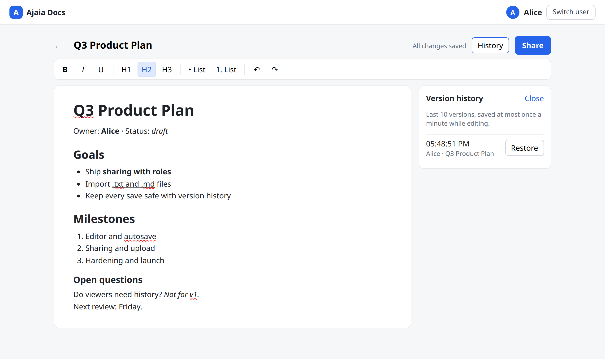

# Ajaia Docs

A lightweight collaborative document editor: create and format documents, import `.txt` / `.md` files, share them
with teammates as **editor** or **viewer**, and roll back with version history.

**Live:** https://ajaia.169-58-1-250.sslip.io



## Try it (reviewers)

No sign-up and no passwords. Pick one of three seeded demo accounts on the login screen:

| User | Use it for |
|---|---|
| **Alice** | Owner: create, format, upload, share |
| **Bob** | Second user: receives shares (e.g. as editor) |
| **Carol** | Third user: receives shares (e.g. as viewer), or has no access |

> **One browser = one login.** All tabs in a browser share the login cookie. To see two users side by side, use a
> normal window for Alice and a private/incognito window for Bob. If you switch user in one tab, other open tabs
> stop saving and offer "Continue as …" so nothing is saved under the wrong account.

**Suggested 3-minute path**
1. Log in as **Alice** → **+ New document** → rename it → use **B / I / U, H1–H3, bullet and numbered lists**.
   Watch "Saving… → All changes saved". Refresh: everything is still there.
2. **⤒ Upload file** → pick a `.md` file (samples below) → it opens as a formatted document.
3. **Share** → Bob = *Can edit*, Carol = *Can view*.
4. Private window → **Bob** → *Shared with me* → open → edit. Back in Alice's window, refresh → Bob's edit is there.
5. **Carol** → opens read-only: no toolbar, no history, a "view-only" note.
6. Alice → **History** → **Restore** an older version (the restore itself can be undone).

**Upload limits:** `.txt` and `.md` only, max **1 MB**. Markdown headings, bold/italic, and lists are kept; links,
images, tables and raw HTML are reduced to plain text (the editor supports a fixed set of formats).

## Features

| Area | What works |
|---|---|
| Documents | Create, rename, edit in the browser, reopen, **delete (owner only)**; dashboard split into *My documents* and *Shared with me* |
| Formatting | Bold, italic, underline, H1–H3, bulleted and numbered lists, undo/redo |
| Saving | Autosave (800 ms debounce, one save in flight per tab, retry when offline, save-on-close) |
| Version history | Last 10 versions per document, snapshot at most once a minute, restore (undoable) |
| Upload | `.txt` / `.md` → new editable document; type, size, encoding validated with clear errors |
| Sharing | Owner grants **Can edit** / **Can view**, changes roles, revokes; enforced on the server |
| Persistence | SQLite: documents, formatting, roles and history survive refresh and restarts |

## Run locally

Requires **Node.js 20+** (22 recommended) and npm.

```bash
git clone https://github.com/motolomibay/ajaia-docs.git
cd ajaia-docs
npm install
npm run dev
```

Open http://localhost:5173. The API runs on port 4540 (Vite proxies `/api`). Data is stored in `data/app.db`
(created on first start, seeded with Alice, Bob and Carol). Delete that file to start fresh.

**Production build (one process serves API + app):**

```bash
npm run build
SESSION_SECRET=any-long-random-string npm start   # http://localhost:4540
```

| Env var | Default | Purpose |
|---|---|---|
| `SESSION_SECRET` | dev value (required in production) | Signs the login cookie |
| `PORT` | `4540` | HTTP port |
| `DB_FILE` | `data/app.db` | SQLite file location |

## Tests

```bash
npm test          # 61 tests: API, permissions, sanitizer, upload, version history, autosave queue
npm run stress    # 6 stress checks against a throwaway server (load, races, uploads, hard kill)
```

What the tests cover is listed in [TEST.md](TEST.md) (every cell of the permission matrix, an IDOR sweep over every
document route, XSS sanitizing, upload validation, autosave ordering, version cap, crash safety).

## Sample files

[`samples/`](samples) holds files for trying upload: `launch.md` and `notes.txt` (valid), `empty.txt` (rejected:
empty), `report.pdf` (rejected: type). For the size limit, upload any `.txt` over 1 MB.

## Documentation

| File | What's in it |
|---|---|
| [ARCHITECTURE.md](ARCHITECTURE.md) | Stack and why, data model, API, access logic, key flows, trade-offs |
| [AI_WORKFLOW.md](AI_WORKFLOW.md) | How AI was used, what I changed or rejected, how I verified it |
| [SUBMISSION.md](SUBMISSION.md) | What's included, what works, what was cut, known limits, next steps |
| [SPEC.md](SPEC.md) | Scope (MUST / NICE / CUT), roles and permission matrix, user flows |
| [TEST.md](TEST.md) | "Done when" criteria, automated, manual and stress tests |
| [AI_LOG.md](AI_LOG.md) | Lap-by-lap log of prompts, changes, failures and fixes |
| [docs/screenshots](docs/screenshots) | Screenshots of every main screen |

## Deployment

Runs on a small VPS: a systemd service (`deploy/ajaia-docs.service`) behind Caddy, which provides HTTPS.
`deploy/deploy.sh` deploys only what is pushed to `main`: fetch → `npm ci` → `npm test` → build → restart →
health check. Production runs from its own checkout, so nothing untested reaches the live site.
